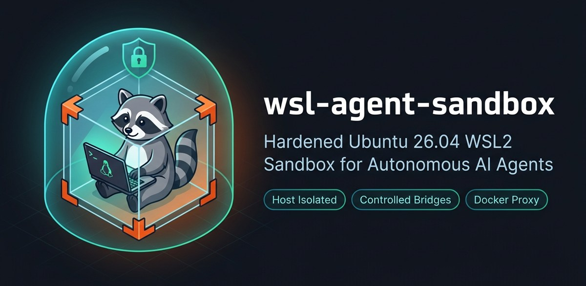

<p align="center">
  
</p>

# `wsl-agent-sandbox` — Hardened Ubuntu 26.04 LTS WSL2 Sandbox for Autonomous AI Agents

A declaratively configured, isolated **Ubuntu 26.04 LTS (Resolute Raccoon)** WSL2 distribution (`wsl-agent-sandbox`) where autonomous AI coding agents (**Gemini CLI**, **Claude Code**, **Codex**, **Antigravity / VS Code Remote-WSL**, or custom agents) can run freely inside Linux while being **strictly contained from accessing your underlying Windows host**, with explicit Windows-side control over every bridge.

---

## Security & Isolation Guarantees

| Boundary | Default Policy | Controlled Bridge |
| :--- | :--- | :--- |
| **Privilege Escalation** | Agent runs as non-root `agent` (UID `26040`), zero `sudo`, locked `root` password. | Admin access only from Windows via `.\box.ps1 root-shell`. |
| **Windows Filesystem** | `/mnt/c` automount disabled (`[automount] enabled=false`), manual `mount -t drvfs` blocked. | Declarative `sharedFolders` allowlist in `box.json` mounted at `/shared/<name>` (`ro` or `rw`). |
| **Windows `.exe` Interop** | Disabled (`[interop] enabled=false`, `appendWindowsPath=false`). | None (Antigravity / VS Code Remote-WSL uses modern script-less startup). |
| **WSLg / Clipboard / `/mnt/wsl`** | Unmounted per-distro (`rprivate` + `umount -l` + `chmod 000`); no X11/Wayland/clipboard/raw sockets. | Root-only `/run/box-root/mnt-wsl` (`0700 root:root`) used exclusively by `docker-policy-proxy`. |
| **Network (WSL → Windows & LAN)** | Per-UID `nftables` (`meta skuid 26040`) drops all new outbound traffic to Windows host & RFC1918 LAN. | Optional `network.allowedHostPorts` in `box.json`; outbound internet remains open. |
| **Network (Windows → WSL)** | `ct state established,related accept` + WSL `localhostForwarding`. | Browse any web app hosted in WSL at `http://localhost:<port>` from Windows! |
| **Docker Desktop** | Docker Desktop WSL Integration stays **OFF** for this distro; root-owned Go `docker-policy-proxy` mediates `/var/run/docker.sock`. | Blocks host drive bind mounts (`/run/desktop/mnt/host/c`, `/mnt/c`, `C:\`), symlink escapes, `--privileged`, dangerous `CapAdd`, `host` namespaces, devices, malicious volume options, Swarm/plugins. Automatically rewrites allowed `/home/agent` (and opted-in `/shared/*`) bind mounts! |
| **Other WSL Distros** | Zero changes to `%USERPROFILE%\.wslconfig` or other distros; `nftables` scoped strictly to UID `26040`. | Optional reference in `examples/wslconfig.optional.ini`. |

---

## Quick Start

```powershell
# 1. Clone the repository:
git clone https://github.com/Thorup/wsl-agent-sandbox.git
cd wsl-agent-sandbox

# 2. Provision Ubuntu 26.04 LTS, build & test the Docker policy proxy, harden, and verify:
.\box.ps1 init
# (Or if installed globally via Scoop / packaging/scoop/wsl-agent-sandbox.json: `wsl-sandbox init`)

# 3. Open an interactive shell as the sandboxed agent user:
.\box.ps1 shell

# 4. Check status (systemd health, active /shared mounts, nftables):
.\box.ps1 status

# 5. Run the full red-team isolation & capability audit at any time:
.\box.ps1 verify
```

---

## Controlling What WSL Can Access on Windows (`box.json` & `box.local.json`)

> **Recommended:** Create a gitignored `box.local.json` next to `box.json` for your local `sharedFolders`, `allowedHostPorts`, or package overrides. `box.ps1` automatically deep-merges `box.local.json` over `box.json` (objects merge recursively; arrays replace cleanly) without leaving a dirty git working tree.

Edit `box.local.json` (or `box.json`) on Windows (invisible to the agent inside WSL), then run `.\box.ps1 apply` to live-reload without rebuilding.

### Share a Specific Windows Folder (Read-Only or Read-Write)
```json
"sharedFolders": [
  {
    "name": "reference-docs",
    "windowsPath": "C:\\Users\\you\\Documents\\reference",
    "mode": "ro",
    "allowDockerBind": true
  }
]
```
After `.\box.ps1 apply`, the folder appears at `/shared/reference-docs` (mounted read-only, and if `allowDockerBind` is `true`, the Docker proxy forces `:ro` even if a container requests `:rw`).

### Allow a Specific Windows Host Port or Port-Forward (e.g., `kubectl port-forward`, SSH Tunnels, Local Ollama)

By default (`network.blockHostAndLan: true`, `allowedHostPorts: []`), direct processes running as `agent` inside WSL **cannot** reach ports bound on your Windows host (including `kubectl port-forward` or SSH tunnels on Windows `127.0.0.1` or LAN IPs) in either `networkingMode=nat` or `networkingMode=mirrored`.

#### Port-Forward Hardening Matrix

Use this table to determine what can reach a port forwarded to your Windows client:

| Configuration in `box.json` | Direct WSL Processes (`agent`) | Containers via Docker Desktop (`host.docker.internal`) | Effective Hardening Level |
| :--- | :--- | :--- | :--- |
| `blockHostAndLan: true`, `allowedHostPorts: []`, `docker.enabled: false` | **Blocked** (NAT & Mirrored) | **Disabled** (no Docker access) | **Strictest** — WSL box cannot reach any Windows host or port-forwarded service. |
| `blockHostAndLan: true`, `allowedHostPorts: []`, `docker.enabled: true` *(default)* | **Blocked** (NAT & Mirrored) | **Reachable via `host.docker.internal:<port>`** (unless `docker.forceInternalNetwork: true` or blocked by Windows Firewall) | **Standard** — Direct WSL egress is blocked, `PortBindings` forced to `127.0.0.1` by default. |
| `blockHostAndLan: true`, `allowedHostPorts: [<port>]` | **Allowed on `<port>` only** | **Reachable** (if `docker.enabled: true`) | **Targeted Bridge** — Explicitly shares only the listed port(s) with WSL. |
| `blockHostAndLan: false` | **Allowed** (all host & LAN ports) | **Reachable** (if `docker.enabled: true`) | **Open Host/LAN** — No host/LAN network isolation. |

> **Security Tip:** If you run sensitive port-forwards on Windows (e.g., `kubectl port-forward` to a production cluster) while an untrusted agent runs in this box, set `"docker": { "enabled": false }` in `box.json` and run `.\box.ps1 apply` (or block Docker Desktop bridge traffic via Windows Firewall).

#### How to Share a Windows Port-Forward with the WSL Box

1. Add the port to `network.allowedHostPorts` in `box.json`:
```json
"network": {
  "blockHostAndLan": true,
  "allowedHostPorts": [
    { "port": 8080, "protocol": "tcp", "comment": "k8s port-forward on Windows" },
    { "port": 11434, "protocol": "tcp", "comment": "Local Ollama on Windows" }
  ]
}
```
2. Run `.\box.ps1 apply` to live-reload `nftables` (and mirrored loopback policy routing) immediately.
3. Connect based on your WSL2 `networkingMode` (in `%USERPROFILE%\.wslconfig`):
   - **Mirrored mode (`networkingMode=mirrored`):** Standard `kubectl port-forward ... 8080:<target>` (bound to `127.0.0.1` on Windows) is reachable directly at `localhost:8080` from inside WSL.
   - **NAT mode (default WSL2):** Windows `127.0.0.1` is not routed into WSL NAT, so bind the forward to your Windows host/WSL interface (e.g., `kubectl port-forward --address 0.0.0.0 ... 8080:<target>` or the `vEthernet (WSL)` IP), allow the port through Windows Firewall if prompted, and connect from WSL to the Windows host gateway IP (`ip route show default | awk '{print $3}'`).

### Add System `apt` Packages & Cloud/Agent/Language Toolchains
Add package names to `packages.apt` or toggle any of the 22 built-in installers in `box.json` (or `box.local.json`) and run `.\box.ps1 apply`:
- **Core Runtimes & Package Managers:** `installDockerCli`, `installUv`, `installNodeLts`, `installPnpm`, `installDotnetSdk`, `installRust`
- **AI Coding Agents:** `installGeminiCli`, `installClaudeCode`, `installCodexCli`, `installOpenCode`, `installAider`
- **Cloud, Kubernetes, IaC & DevOps CLIs:** `installKubectl`, `installHelm`, `installOpenTofu`, `installAwsCli`, `installGcloudCli`, `installAzureCli`, `installAzureDevopsCli`, `installGithubCli`, `installJiraCli`, `installUpctl`, `installPlaywrightChromium`

(User-space tools via `uv`, `pip`, `npm`, `pnpm`, `cargo`, `rustup`, and `dotnet tool install -g` can also be installed freely by the agent inside `/home/agent` without `sudo`.)

### Named Multi-Box Profiles (`-Profile <name>` & `.\box.ps1 list`)
Run multiple independent, isolated sandboxes side-by-side (each with its own WSL distribution, VHDX directory, and deterministic high UID in `26100..26998` so per-UID `nftables` rules never collide):
- Create an optional `box.<profile>.json` (or `profiles/<profile>.json`) override file, or pass `-Profile <name>` directly to any command (`.\box.ps1 init -Profile untrusted`, `.\box.ps1 shell -Profile untrusted`, `.\box.ps1 apply -Profile untrusted`).
- Run `.\box.ps1 list` to inspect all configured sandbox profiles, their resolved distro names, UIDs, and WSL installation states.

---

## Using Other AI Agents (Claude Code, Codex, etc.)

Because every containment boundary (non-root UID `26040`, no `sudo`, no `/mnt/c`, no Windows interop, no WSLg/clipboard, per-UID `nftables` + `loopback0` blocking, and `docker-policy-proxy`) is enforced at the **Linux OS / kernel / systemd level**, this box works identically for **any** CLI or IDE agent:
- **Gemini CLI** (`gemini` — pre-installed by default; toggle `installGeminiCli` in `box.json`)
- **Claude Code** (`claude` — pre-installed by default; toggle `installClaudeCode` in `box.json`)
- **OpenAI Codex CLI** (`codex` — toggle `installCodexCli: true` in `box.json`), **OpenCode** (`opencode` — toggle `installOpenCode: true`), **Aider** (`aider` — toggle `installAider: true`), or custom agents (installable via ` box.json` toggles or in user-space via `npm`/`uv`)

> **Cloud Credentials Note**: Any credentials you configure inside `/home/agent` (`~/.aws`, `~/.azure`, `~/.config/gcloud`, `~/.config/gh`, `~/.config/.jira`, `~/.config/upctl.yaml`, `~/.kube/config`) are accessible to autonomous agents running in this box. Use dedicated, least-privilege sandbox accounts/clusters or short-lived tokens rather than production admin credentials.

---

## Seeding & Rotating CLI Service Secrets (from Windows)

You can seed and rotate machine account tokens and service account credentials for your CLI tools directly from a **central Windows location** — completely outside `.\box.ps1 init` and `.\box.ps1 apply`, without navigating inside Linux or storing any secrets in `box.json` / git.

### 1. Create Your Central Windows Secrets Manifest

Create a folder outside the repository (default: `%USERPROFILE%\.wsl-agent-sandbox\`) and copy [examples/secrets.example.json](examples/secrets.example.json) into `%USERPROFILE%\.wsl-agent-sandbox\secrets.json` (plus any service account JSON keys, PEM certificates, kubeconfigs, or raw token files in subdirectories like `keys/` or `tokens/`):

```powershell
New-Item -ItemType Directory -Path "$env:USERPROFILE\.wsl-agent-sandbox" -Force | Out-Null
Copy-Item .\examples\secrets.example.json "$env:USERPROFILE\.wsl-agent-sandbox\secrets.json"
```

Every secret field supports **four mutually exclusive sources**:
- **Inline value** (e.g., `"token": "..."`)
- **Relative or absolute Windows file** (e.g., `"tokenFile": "tokens/github.txt"`, `"serviceAccountKeyFile": "keys/gcp-sa.json"` — relative paths resolve against the directory containing `secrets.json`, and `%ENVVAR%` expansion is supported)
- **Windows environment variable** (e.g., `"tokenEnv": "SANDBOX_GH_TOKEN"`)
- **Password manager or cloud vault URI** (e.g., `"tokenVault": "op://Sandbox/GitHub/pat"` — supports `op://` 1Password CLI, `bw://` Bitwarden CLI, `dpapi://` Windows CurrentUser DPAPI encrypted file, `azkv://` Azure Key Vault, `awssm://` AWS Secrets Manager, and `gcpsm://` GCP Secret Manager, resolved on Windows at seed time)

Manifest path resolution priority:
1. CLI argument: `.\box.ps1 seed-secrets "D:\vault\secrets.json"` or `-SecretsPath "D:\vault\secrets.json"`
2. Windows environment variable: `$env:WSL_AGENT_SANDBOX_SECRETS_PATH`
3. Optional non-secret pointer in `box.json`: `"secrets": { "manifestPath": "%USERPROFILE%\\.wsl-agent-sandbox\\secrets.json" }`
4. Default: `%USERPROFILE%\.wsl-agent-sandbox\secrets.json`

### 2. Seed, Rotate, or Revoke Secrets Independently of `init` / `apply`

```powershell
# Preview and validate without pushing any secrets:
.\box.ps1 seed-secrets -DryRun

# Seed all enabled services from %USERPROFILE%\.wsl-agent-sandbox\secrets.json:
.\box.ps1 seed-secrets

# Rotate only specific service(s) after updating tokens in your central Windows folder:
.\box.ps1 seed-secrets -Service github,jira

# Seed and prune credentials for any service you disabled or removed from secrets.json:
.\box.ps1 seed-secrets -Prune

# Revoke managed credentials inside WSL (all, or specific service(s)):
.\box.ps1 clear-secrets
.\box.ps1 clear-secrets -Service aws,gcloud
```

### Supported CLI Services (`secrets.schema.json`)

| Service Key | CLI / Tool | Auth Mechanism & Linux Target |
| :--- | :--- | :--- |
| `github` | `gh` + `git` (HTTPS) | Machine account / fine-grained PAT → `~/.config/gh/hosts.yml`, `gh auth setup-git`, optional `GH_TOKEN` / `GH_ENTERPRISE_TOKEN` (and optional `loginOnline: true`); supports `"proxyInject": true` (`GITHUB_API_URL=http://127.0.0.1:3129/github`). |
| `git` | `git` (SSH + signing) | Dedicated Git SSH keys (plus optional `.pub` & OpenSSH `-cert.pub` certs) → `~/.ssh/wsl-agent-sandbox-git/` (`0600`), independent Git `Host` stanzas in `~/.ssh/config`, pinned `known_hosts`, plus optional Git identity (`user.name`/`user.email`), SSH commit/tag signing (`gpg.format = ssh`, `allowed_signers`), and HTTPS-to-SSH rewrites via `~/.config/wsl-agent-sandbox/gitconfig`. |
| `aws` | `aws` | IAM access keys / STS tokens (single or multi-profile) → `~/.aws/credentials`, `~/.aws/config`, optional `AWS_PROFILE`. |
| `gcloud` | `gcloud` + GCP SDKs | Service Account JSON key → `~/.config/wsl-agent-sandbox/keys/gcloud-service-account.json`, `gcloud auth activate-service-account`, project/region/zone config, `GOOGLE_APPLICATION_CREDENTIALS`. |
| `azure` | `az` + Azure SDKs | Entra ID Service Principal (client secret or PEM cert) → `az login --service-principal`, optional subscription, `AZURE_CLIENT_ID`/`AZURE_TENANT_ID`/`AZURE_CLIENT_SECRET` (or `AZURE_CLIENT_CERTIFICATE_PATH`). |
| `azureDevops` | `az devops` | Personal Access Token → `AZURE_DEVOPS_EXT_PAT` + `az devops configure --defaults organization=... project=...`. |
| `jira` | `jira` (`jira-cli`) | API token → `~/.config/.jira/.config.yml` + `JIRA_API_TOKEN`; supports `"proxyInject": true` (Basic/Bearer auth stored only in root proxy, `server` set to `http://127.0.0.1:3129/jira`). |
| `upcloud` | `upctl` | API token (or subaccount username/password) → `~/.config/upctl.yaml` + optional `UPCLOUD_TOKEN`. |
| `kubectl` | `kubectl` | Dedicated kubeconfig file OR Service Account bearer token → `~/.kube/config` + optional context switch. |
| `gemini` | `gemini` | `GEMINI_API_KEY` and/or Vertex AI; supports `"proxyInject": true` (`GOOGLE_GEMINI_BASE_URL=http://127.0.0.1:3129/gemini` + placeholder token). |
| `claude` | `claude` | `ANTHROPIC_API_KEY` and/or `CLAUDE_CODE_OAUTH_TOKEN`; supports `"proxyInject": true` (`ANTHROPIC_BASE_URL=http://127.0.0.1:3129/claude` + placeholder tokens). |
| `ssh` | `ssh` / `scp` / `sftp` | Named SSH private keys for remote servers/bastions (plus optional `.pub` & OpenSSH user `-cert.pub` certificates) → `~/.ssh/wsl-agent-sandbox/` (`0600`), marker-delimited `Host` stanzas & optional `defaultKey` in `~/.ssh/config`, and pinned `known_hosts`. |
| `env` | Any CLI | Additional custom token environment variables exported into `~/.config/wsl-agent-sandbox/secrets.env` (protected system vars like `PATH`/`DOCKER_HOST`/`LD_PRELOAD` are rejected). |
| `files` | Any CLI | Additional secret files (e.g., `~/.npmrc`, `~/.netrc`) copied atomically with `0600` strictly inside `/home/<agent>/`. |

> **Git SSH & Commit Signing Notes**:
> - Rotate or revoke Git SSH keys independently of remote server `ssh` credentials with `.\box.ps1 seed-secrets -Service git` or `.\box.ps1 clear-secrets -Service git`. Managed Git keys live in `~/.ssh/wsl-agent-sandbox-git/` and use their own marker-delimited block in `~/.ssh/config` (ahead of `ssh`'s `Host *` defaults), so `git` and `ssh` never clobber each other.
> - Supports both a concise single-host shorthand (`"host": "github.com"`, `"privateKeyFile": "..."`) and multi-host / per-repo deploy-key aliases (`keys[]` + `hosts[]` for GitHub, GitLab, Azure DevOps `ssh.dev.azure.com`, Bitbucket, etc.), plus optional `userName`/`userEmail`, SSH commit/tag signing (`signing` → `gpg.format = ssh` + `allowed_signers` in `~/.config/wsl-agent-sandbox/gitconfig` included from `~/.gitconfig`), and optional `rewriteHttpsToSsh`.
> - `StrictHostKeyChecking` is computed per Git host (`yes` when pinned known hosts cover that host, `accept-new` otherwise), and `BatchMode` defaults to `true` so agents fail fast instead of hanging on interactive SSH prompts. If you also use `github` with `"gitProtocol": "ssh"`, configure `git` alongside `github` to supply the SSH key.

> **SSH Remote Server Access Notes**:
> - Rotate or revoke agent SSH keys at any time with `.\box.ps1 seed-secrets -Service ssh` or `.\box.ps1 clear-secrets -Service ssh`. Managed keys live strictly in `~/.ssh/wsl-agent-sandbox/` and `~/.ssh/config` uses marker-delimited blocks, so manual user keys and custom `~/.ssh/config` entries are never overwritten; stale managed keys are automatically pruned on rotation.
> - Use dedicated, least-privilege remote accounts and passphrase-less deploy keys (or short-lived OpenSSH user certificates via `certificate`/`certificateFile`) with pinned `knownHosts` / `knownHost` entries. `StrictHostKeyChecking` defaults to `yes` when pinned known hosts are provided, or `accept-new` otherwise.
> - `seed-secrets` never weakens `box.json` network isolation: public remote SSH servers work out of the box, while RFC1918 / LAN / Tailscale targets (`10.0.0.0/8`, `172.16.0.0/12`, `192.168.0.0/16`, `100.64.0.0/10`) remain governed by `network.blockHostAndLan` and `network.blockedCidrs` in `box.json` (or reachable via a public `proxyJump` bastion / `allowedHostPorts` tunnel).

> **Security Guarantees**: Your central Windows secrets folder is **never** mounted into WSL (`/shared` or `/mnt/c`) and **never** written to `box.json` or `/etc/wsl-agent-sandbox/policy.json`. Any secret field also accepts a `<field>Vault` URI (`op://`, `bw://`, `dpapi://`, `azkv://`, `awssm://`, or `gcpsm://`) resolved on Windows at seed time so plaintext tokens never need to rest on disk. Windows resolves file/env/vault references locally, pipes the payload strictly over `stdin` to the root control plane (`wsl -u root`), writes all files atomically with `0600` permissions owned by `agent:agent`, redacts secret strings from any error output, and automatically loads `~/.config/wsl-agent-sandbox/secrets.env` in agent shells.

---

## Connecting Antigravity / VS Code Remote-WSL

1. Launch Antigravity / VS Code **from Windows**.
2. Connect via **Remote - WSL** to distro `wsl-agent-sandbox`.
3. Modern Remote-WSL uses script-less startup and works cleanly with `[interop] enabled=false` and `[automount] enabled=false`.

---

## Important Security Notes

1. **Keep Docker Desktop "WSL Integration" OFF for `wsl-agent-sandbox`**: Do not toggle `wsl-agent-sandbox` on in Docker Desktop's WSL Integration settings. Our root-owned `docker-policy-proxy` already connects to Docker Desktop cleanly while preventing raw socket exposure.
2. **Docker Desktop Container Bridge Egress**: While direct WSL processes (`agent` UID `26040`) are blocked from reaching Windows host ports by `nftables`, and containers cannot use `--network=host` or `--add-host=...:host-gateway`, containers running inside Docker Desktop's own bridge network can still resolve `host.docker.internal` unless restricted via Windows Firewall. Filesystem and privilege escapes via Docker are fully blocked by `docker-policy-proxy`.
3. **Global `.wslconfig` (`networkingMode`)**: `wsl-agent-sandbox` works cleanly in **both** `networkingMode=nat` and `networkingMode=mirrored` without modifying your global `%USERPROFILE%\.wslconfig`. In `networkingMode=mirrored`, `box-hardening.sh` installs per-UID (`uidrange 26040-26040`) policy routing + `nftables` `ct mark 0x2604` rules on `loopback0` so `agent` is blocked from reaching Windows `127.0.0.1` ports while Windows → WSL `localhost` web browsing and WSL-internal `127.0.0.1` services continue working seamlessly.

---

## Lifecycle Commands

All commands accept `-Profile <name>` (alias `-ProfileName`) to target a named sandbox profile and `-ConfigPath <path>` to use a custom config file.

- `.\box.ps1 init [-SaveGolden]` — Full download (with SHA256 verification), import, provision, harden, verify, and save initial golden snapshot.
- `.\box.ps1 up` — Ensure the distro is running and systemd hardening services are active (runs `init` if not installed).
- `.\box.ps1 apply [-RebuildProxy]` — Hot-reload `box.json` / `box.local.json` changes (mounts, ports, Docker policy, `apt` packages, CLI/language toolchains); pass `-RebuildProxy` to rebuild `docker-policy-proxy`.
- `.\box.ps1 upgrade [-Scope all|apt,agents,toolchains]` — Update installed `apt` packages, AI agents, and toolchains in place.
- `.\box.ps1 doctor` — Run Windows + WSL preflight diagnostics (WSL2, `.wslconfig`, Docker Desktop, systemd, VHDX size, image cache).
- `.\box.ps1 compact` — Run `fstrim` inside WSL and compact `ext4.vhdx` to reclaim disk space (requires elevated Administrator PowerShell).
- `.\box.ps1 logs` / `.\box.ps1 audit` — View root-owned security events (`nftables` drops, `docker-policy-proxy` denials, `box-hardening` reloads) filtered by `-Source <all|docker|network|hardening>`, `-Since <time>`, and `-Lines <1..100000>`.
- `.\box.ps1 list` — List all configured sandbox profiles (`default` + `box.<profile>.json` / `profiles/<profile>.json`), their distro names, UIDs, and WSL installation states.
- `.\box.ps1 push-repo <path> [-Dest <relpath>] [-Branch <ref>] [-Force]` / `pull-diff <name>` / `pull-branch <name> [-RepoPath <winPath>] [-Branch <ref>]` — Transfer git repos via bundle onto native Linux `ext4` (`~/work/<name>`) and pull reviewable `sandbox/<name>` branches back without `rw` `/shared` mounts.
- `.\box.ps1 seed-secrets [path]` — Seed or rotate CLI service tokens and service account credentials from a central Windows manifest (independently of `init`/`apply`); supports `-SecretsPath <path>`, `-Service <names>`, `-Ttl <dur>` (ephemeral auto-expiration enforced by root systemd timers, also configurable per service via `ttl`), `-Prune`, and `-DryRun`.
- `.\box.ps1 clear-secrets [-Service <names>]` — Revoke managed seeded CLI credentials inside WSL (all or scoped to specific service(s)).
- `.\box.ps1 verify` — Run full red-team isolation audit + Windows ↔ WSL `localhost` web test.
- `.\box.ps1 status` — Inspect systemd services, active `/shared` mounts, seeded CLI secrets, VHDX disk footprint, resource quotas, and `nftables` rules.
- `.\box.ps1 register-terminal [-Unregister]` — Add or update a dedicated Windows Terminal profile for this sandbox (pass `-Unregister` to remove it).
- `.\box.ps1 shell` / `.\box.ps1 root-shell` — Open agent shell or Windows-side admin root shell.
- `.\box.ps1 snapshot [path] [-Golden]` — Export a `.tar` backup of the distro (pass `-Golden` to save `.cache\<distro>-golden.tar`).
- `.\box.ps1 restore <path> [-Force]` — Import a `.tar` backup, re-apply `box.json` policy, and run `verify`.
- `.\box.ps1 reset [-Full] [-SaveGolden] [-Force]` / `.\box.ps1 destroy [-Force]` — Fast-restore from golden snapshot (pass `-Full` for clean Ubuntu rebuild) or remove the distro completely.

---

## License

Licensed under the [GNU General Public License v3.0](LICENSE).
